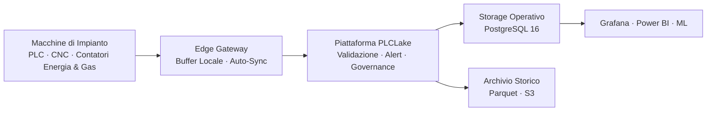
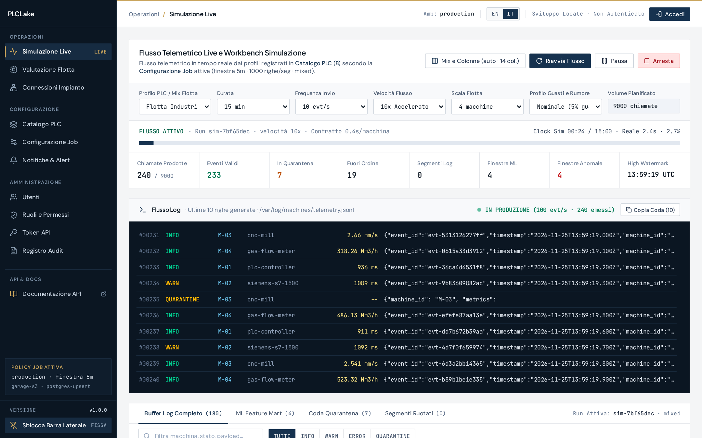
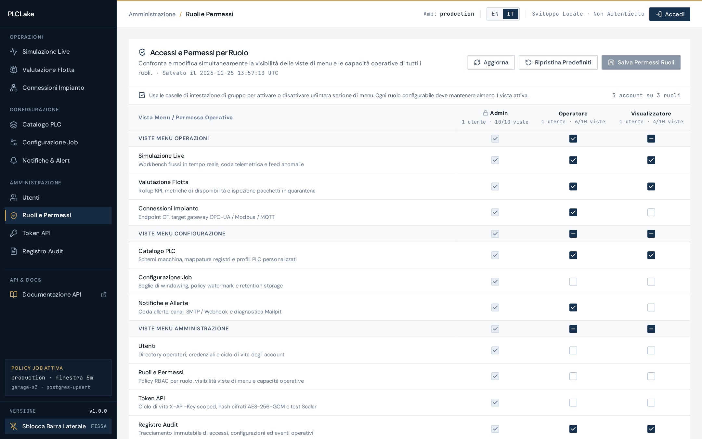

# PLCLake — Industrial Telemetry Connector

**Piattaforma di Telemetria Industriale, Edge Gateway & ML Lakehouse**

<p align="center">
  <a href="README.md">English</a> · <strong>Italiano</strong>
</p>

<!-- BADGES:START -->
<p align="center">
  
  
  
  
  
  <br />
  
  
  
  
  
</p>
<!-- BADGES:END -->

---

## Cos'è PLCLake?

**PLCLake** raccoglie in tempo reale i dati delle macchine di stabilimento (PLC, centri CNC, compressori, contatori elettrici e gas) e li trasforma in **visibilità operativa immediata**, **alert preventivi sui guasti** e **dati puliti pronti per analisi** su Grafana, Power BI e modelli di Manutenzione Predittiva — senza dover gestire infrastrutture big-data complesse o costose in fabbrica.

È progettato per girare **on-premise sul server del cliente**, in **reti di stabilimento isolate (air-gapped)** oppure su **cloud / Kubernetes**.



---

## Valore per Ogni Ruolo

| Profilo | Cosa Ottiene da PLCLake |
| :--- | :--- |
| **Plant & Operations Manager** | Controllo in tempo reale di stato macchine, anomalie e fermi impianto, con notifiche automatiche via email e webhook prima che un'anomalia diventi un fermo critico. |
| **Business Manager & Controllo di Gestione** | Flussi giornalieri puliti e certificati su disponibilità (OEE), ore di fermo, consumi elettrici (kWh) e gas (Nm3), pronti per Power BI e Grafana. |
| **CTO, Team Lead & IT/OT** | Architettura full-stack moderna e snella (React, TypeScript, Node.js, PostgreSQL, Python Edge), API OpenAPI 3.1 tipizzate, sicurezza RBAC + Audit Log e deploy pronto per Docker e Kubernetes/Helm. |

---

## Anteprima della Piattaforma

### Streaming Telemetrico in Tempo Reale


### Le 4 Viste Principali

<table>
  <tr>
    <td width="50%" valign="top">
      <a href="docs/assets/screenshots/01-live-console-it.png"></a>
      <br />
      <strong>1. Console Operativa Live</strong><br />
      Indicatori KPI in tempo reale, quarantena anomalie e ispezione eventi JSON.
    </td>
    <td width="50%" valign="top">
      <a href="docs/assets/screenshots/02-plc-catalog-it.png"></a>
      <br />
      <strong>2. Catalogo Dinamico PLC</strong><br />
      Configura macchinari Siemens, Rockwell, CNC, Gas ed Energia, protocolli e soglie.
    </td>
  </tr>
  <tr>
    <td width="50%" valign="top">
      <a href="docs/assets/screenshots/03-rbac-roles-it.png"></a>
      <br />
      <strong>3. Accessi e Permessi (RBAC)</strong><br />
      Gestisci viste e permessi per <code>Admin</code>, <code>Operatore</code> e <code>Visualizzatore</code>.
    </td>
    <td width="50%" valign="top">
      <a href="docs/assets/screenshots/04-api-docs-it.png"></a>
      <br />
      <strong>4. Portale API OpenAPI 3.1</strong><br />
      Esplora e testa tutti i 51 endpoint tipizzati con autenticazione e docs <code>IT | EN</code>.
    </td>
  </tr>
</table>

---

## Funzionalità Principali

- **Console Operativa & Simulazione Live**: monitora i flussi telemetrici in tempo reale, ispeziona l'intero payload JSON di ogni evento, isola automaticamente i dati anomali in quarantena e valuta lo stato della flotta.
- **Catalogo PLC Dinamico & Connessioni Impianto**: configura macchine industriali (Siemens, Rockwell, CNC, Gas, Energia) con canali personalizzati, test di raggiungibilità e sincronizzazione automatica con l'Edge Gateway.
- **Sicurezza, Ruoli & Tracciabilità**: gestione separata di Utenti e Ruoli (`Admin`, `Operator`, `Viewer`), chiavi API gestite con scadenza e rotazione, segreti cifrati a riposo e registro Audit immutabile su tutte le modifiche.
- **Nativamente Bilingue (`IT | EN`)**: console web, portale API interattivo e manuali tecnici sono sincronizzati 1:1 in Italiano e Inglese.
- **Pronto per la Produzione**: versione centralizzata (`config/app.json` + `/api/v1/version`), immagine Docker non-root, pacchetto on-premise chiavi in mano, Helm Chart per k3s/Kubernetes e pipeline CI/CD automatiche.

---

## Punti Chiave Architetturali (Per Team Tecnici)

- **Zero Over-Engineering**: PostgreSQL 16 + PgBouncer per query operative istantanee ("Hot") abbinato ad archivio compresso Parquet su S3 ("Cold") — nessun cluster Kafka o Spark da mantenere in stabilimento.
- **API Contract-First**: 51 endpoint OpenAPI 3.1 generati direttamente da schemi Zod, con validazione a due livelli (`permissive` per resilienza in fabbrica, `strict` per integrazioni enterprise) e portale interattivo Scalar.
- **Osservabilità Nativa**: endpoint `/healthz`, `/readyz`, `/api/v1/version`, metriche Prometheus `/metrics`, log JSON strutturati con redaction dei segreti e dashboard Grafana preconfigurate.

Tutti gli approfondimenti tecnici sono raccolti nell'[Hub Documentazione](docs/index.md).

---

## Avvio Rapido

### Sviluppo Locale

```bash
cp .env.example .env
npm install
npm run hooks:install
npm run dev
```

### Stack Completo con Docker

Avvia **PLCLake + PostgreSQL 16 + Mailpit + Prometheus + Grafana** con un solo comando:

```bash
docker compose up -d --build
```

| Servizio | URL |
| :--- | :--- |
| **Console Web (IT / EN)** | `http://localhost:3000` |
| **API Versione Release** | `http://localhost:3000/api/v1/version` |
| **Documentazione API Interattiva (IT)** | `http://localhost:3000/api/v1/docs?lang=it` |
| **Documentazione API Interattiva (EN)** | `http://localhost:3000/api/v1/docs?lang=en` |
| **Metriche Prometheus** | `http://localhost:3000/api/v1/metrics` |

Per il rilascio su server cliente o ambienti Staging/Produzione:
- **[Guida Deploy On-Premise & Air-Gapped (Docker)](deploy/onprem/README.md)**
- **[Guida Deploy Kubernetes / k3s con Helm (Staging & Prod)](deploy/helm/plclake/README.md)**

---

## Documentazione

Tutta la documentazione tecnica è rispecchiata 1:1 in Italiano e Inglese:

- **[Hub Documentazione (IT / EN)](docs/index.md)**
- **[Topologia OT/IT & Edge Gateway](docs/it/architecture/ot-it-topology.md)**
- **[Hot/Cold Lakehouse & Big Data](docs/it/architecture/hot-cold-lakehouse.md)**
- **[Catalogo PLC Dinamico & Contratto Output](docs/it/guides/plc-catalog-and-output.md)**
- **[Guida Giorno 1: PLC verso Grafana & Power BI](docs/it/guides/grafana-powerbi.md)**
- **[Sicurezza: Auth, API Key & Hardening](docs/it/security/api-auth-and-hardening.md)**
- **[API Reference & Guida Estrazione Dati](docs/it/api/reference.md)**
- **[Governance i18n, CI & Automazione](docs/it/guides/i18n-and-docs-governance.md)**

---

## Comandi di Qualità & Manutenzione

```bash
npm run verify         # Controllo completo pre-push (TypeScript, ESLint, Biome, i18n, Vitest, Build Frontend e Server)
npm test               # Test automatici su sicurezza, RBAC, ciclo di vita token, DB e API
npm run sync:badges    # Allinea la versione di config/app.json su package.json, Helm Chart e badge README
npm run docs:openapi   # Esporta le specifiche statiche OpenAPI 3.1 EN/IT
```

---

## Licenza

Distribuito con licenza [Apache License 2.0](LICENSE).
