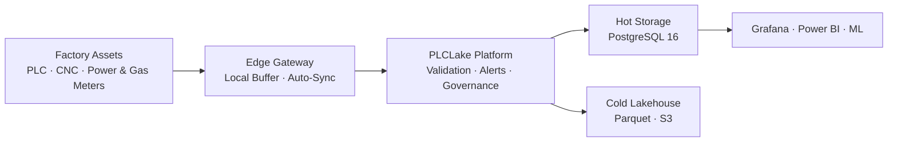
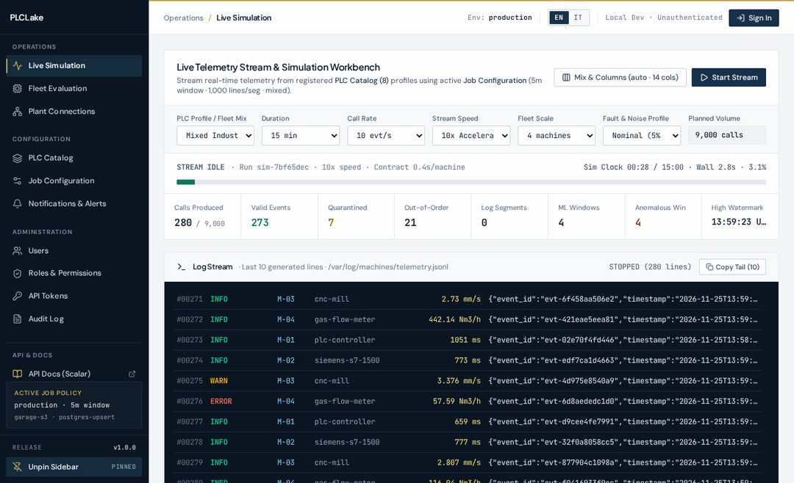
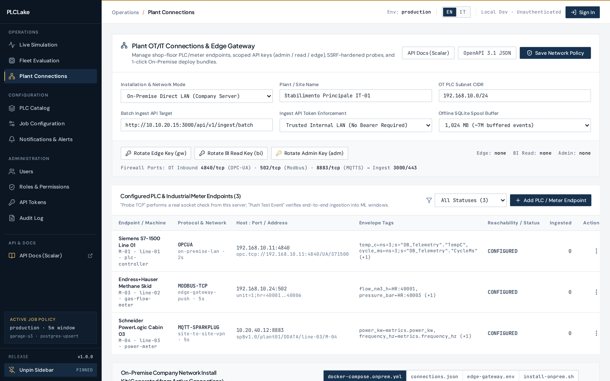
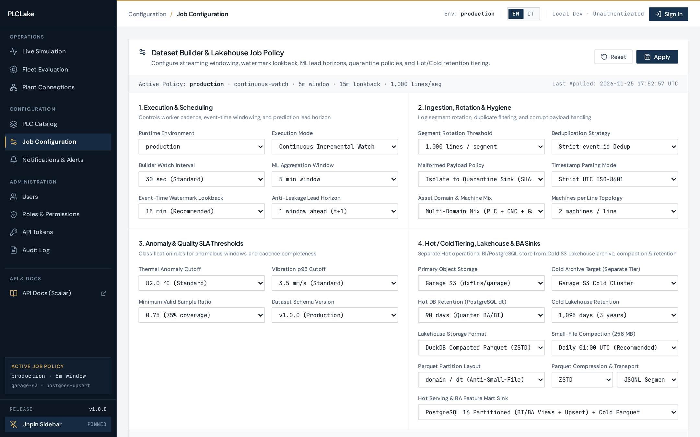
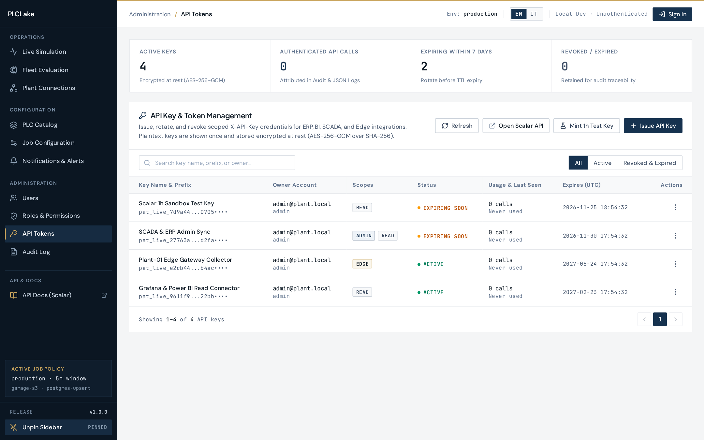
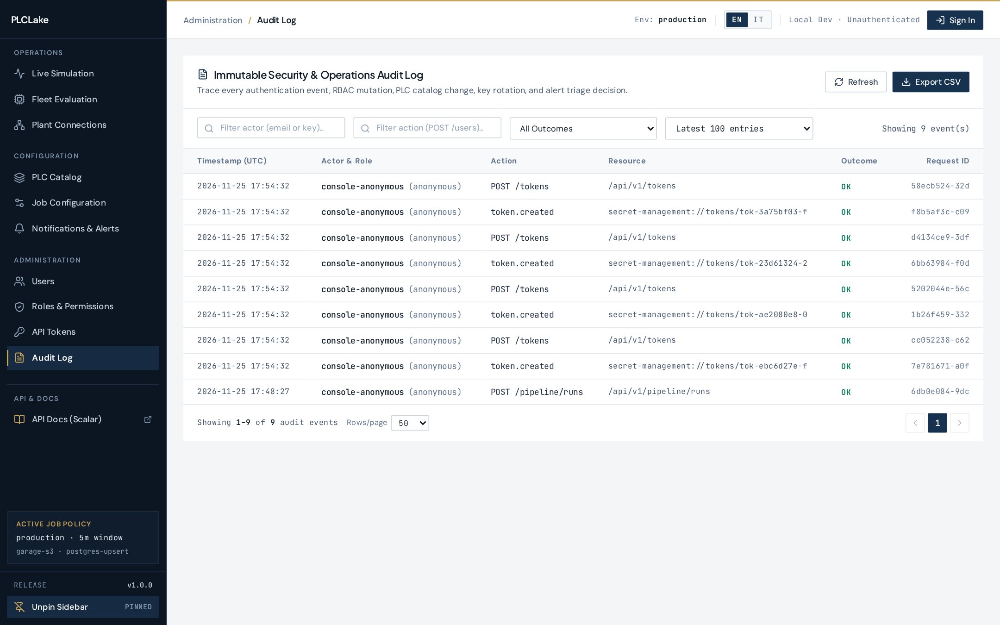

# PLCLake — Industrial Telemetry Connector

**Industrial Telemetry, Edge Gateway & ML Lakehouse Platform**

<p align="center">
  <strong>English</strong> · <a href="README.it.md">Italiano</a> · <a href="https://salvo8519.github.io/plclake/en/">Live Docs</a> · <a href="https://salvo8519.github.io/plclake/api/scalar.html?lang=en">Interactive API (Scalar)</a>
</p>

<!-- BADGES:START -->
<p align="center">
  
  
  
  
  
  <br />
  
  
  
  
  
</p>
<!-- BADGES:END -->

---

## What is PLCLake?

**PLCLake** collects live data from factory machines (PLCs, CNC mills, compressors, power and gas meters) and turns it into **real-time operational visibility**, **early fault alerts**, and **clean analytics datasets** for Grafana, Power BI, and Predictive Maintenance — without requiring complex or expensive big-data clusters on the shop floor.

It is built to run **on-premise inside a plant**, in **isolated (air-gapped) networks**, or on **cloud / Kubernetes** environments.



---

## Value by Audience

| Audience | What PLCLake Delivers |
| :--- | :--- |
| **Plant & Operations Managers** | Live monitoring of machine status, anomalies, and downtime, with automated email and webhook alerts before failures escalate. |
| **Business & Finance Controllers** | Clean, structured daily feeds for availability (OEE), downtime hours, energy usage (kWh), and gas volume (Nm3) ready for Power BI and Grafana. |
| **CTO, Tech Leads & IT/OT Teams** | Lightweight, maintainable full-stack architecture (React, TypeScript, Node.js, PostgreSQL, Python Edge), typed OpenAPI 3.1 APIs, enterprise RBAC, and turnkey Docker/Helm deployment. |

---

## Platform Preview

### Live Telemetry Streaming



### Operations, Plant Connectivity & Pipeline Configuration

<table>
  <tr>
    <td width="50%" valign="top">
      <a href="docs/assets/screenshots/01-live-console-en.png"></a>
      <br />
      <strong>1. Live Operations Console</strong><br />
      Real-time KPI counters, pipeline health status, quarantined anomalies, and raw JSON telemetry inspection.
    </td>
    <td width="50%" valign="top">
      <a href="docs/assets/screenshots/05-plant-connections-en.png"></a>
      <br />
      <strong>2. Plant Connections &amp; Edge Gateway</strong><br />
      Connect shop-floor assets over OPC-UA, Modbus TCP, MQTT Sparkplug, or VPN/LAN with offline SQLite spooling and 1-click on-premise install bundles.
    </td>
  </tr>
  <tr>
    <td width="50%" valign="top">
      <a href="docs/assets/screenshots/02-plc-catalog-en.png"></a>
      <br />
      <strong>3. Dynamic PLC Catalog</strong><br />
      Configure Siemens, Rockwell, CNC, Gas, and Power profiles, protocols, fault thresholds, and analytics formulas without writing code.
    </td>
    <td width="50%" valign="top">
      <a href="docs/assets/screenshots/06-job-config-en.png"></a>
      <br />
      <strong>4. Job Configuration &amp; Hot/Cold Lakehouse</strong><br />
      Tune sliding aggregation windows, watermark lookback, quarantine rules, anomaly SLAs, and Hot PostgreSQL vs. Cold Parquet S3 retention.
    </td>
  </tr>
</table>

### Security, Governance & Interactive API

<table>
  <tr>
    <td width="50%" valign="top">
      <a href="docs/assets/screenshots/03-rbac-roles-en.png"></a>
      <br />
      <strong>5. Role-Based Access Control (RBAC)</strong><br />
      Control view visibility and operational permissions for <code>Admin</code>, <code>Operator</code>, and <code>Viewer</code> roles from a unified matrix.
    </td>
    <td width="50%" valign="top">
      <a href="docs/assets/screenshots/07-api-tokens-en.png"></a>
      <br />
      <strong>6. API Keys &amp; Token Lifecycle</strong><br />
      Issue, rotate, and revoke scoped <code>X-API-Key</code> credentials (<code>read</code>, <code>edge</code>, <code>admin</code>) with expiration alerts and AES-256-GCM encryption at rest.
    </td>
  </tr>
  <tr>
    <td width="50%" valign="top">
      <a href="docs/assets/screenshots/08-audit-log-en.png"></a>
      <br />
      <strong>7. Immutable Security &amp; Operations Audit Log</strong><br />
      Track every login, key issuance/rotation, RBAC update, and configuration change with Actor, Outcome, Request ID, and CSV export.
    </td>
    <td width="50%" valign="top">
      <a href="https://salvo8519.github.io/plclake/api/scalar.html?lang=en"></a>
      <br />
      <strong>8. Interactive OpenAPI 3.1 Portal (<a href="https://salvo8519.github.io/plclake/api/scalar.html?lang=en">Open Live Scalar</a>)</strong><br />
      Explore and test all 51 typed endpoints directly in the browser with built-in authentication and synchronized <code>EN | IT</code> docs.
    </td>
  </tr>
</table>

---

## Key Capabilities

- **Live Telemetry & Simulation Console**: Monitor incoming machine streams, pipeline health (`Stable`, `Degraded`, `Critical`), raw JSON payloads, quarantined anomalies, and fleet KPIs in real time.
- **Plant Connections & Edge Gateway**: Connect factory assets via **OPC-UA**, **Modbus TCP**, **MQTT Sparkplug**, or **HTTP/REST** over direct LAN, Site-to-Site VPN, or an offline-resilient Edge Gateway with SQLite store-and-forward buffering and generated 1-click on-premise install kits.
- **Dynamic PLC Catalog & Job Policy**: Define industrial machine families (Siemens, Rockwell, CNC, Gas, Power) and tune aggregation windows, event-time watermarks, quarantine policies, and Hot/Cold Lakehouse retention straight from the UI.
- **Security, API Tokens & Immutable Audit Log**: Manage Users and RBAC roles (`Admin`, `Operator`, `Viewer`), issue scoped `X-API-Key` credentials (`read`, `edge`, `admin`) with TTL tracking and rotation, encrypt secrets at rest, and export an immutable audit trail of every operational action. Production fails closed: mandatory authentication, no default credentials, SSRF protection with DNS pinning, CSP/HSTS headers.
- **Bilingual by Design (`EN | IT`) & Production Ready**: Synchronized English/Italian console, live Scalar OpenAPI portal, Zensical documentation site, hardened non-root Docker image, on-premise Compose bundle, and Kubernetes/k3s Helm chart.

---

## Architecture Highlights (For Technical Teams)

- **Zero Over-Engineering**: PostgreSQL 16 + PgBouncer for fast recent queries ("Hot" tier) paired with compressed Parquet on S3 ("Cold" tier) — no Kafka or Spark clusters to maintain on-site.
- **Contract-First APIs**: 51 OpenAPI 3.1 endpoints generated directly from Zod schemas, with two-tier validation (`permissive` for resilient ingestion, `strict` for integrations) and interactive [Scalar OpenAPI 3.1 Reference](https://salvo8519.github.io/plclake/api/scalar.html?lang=en).
- **Production Observability**: Built-in `/healthz`, `/readyz`, `/api/v1/version`, Prometheus `/metrics`, redacted structured JSON logs, and pre-provisioned Grafana dashboards.
- **Modular, Verifiable HTTP Layer**: `server.ts` is a small composition root; each domain (auth, alerts, catalog, ingestion, connections, analytics, pipeline, docs) is a router in `src/http/routes/`. A route-table snapshot test doubles as an authorization map, so a route that loses its protection fails CI.
- **Reproducible Builds**: committed `package-lock.json` (`npm ci`) and a hash-verified Python lock; CI runs `npm audit` and `pip-audit`.

Deep-dive technical guides are published on the **[Live Documentation Site](https://salvo8519.github.io/plclake/en/)** and mirrored in the [Documentation Hub](docs/index.md).

---

## Quick Start

### Local Development

```bash
cp .env.example .env
npm ci
npm run hooks:install
npm run dev
```

No password is hard-coded. Set `AUTH_ADMIN_PASSWORD` in `.env`, or leave it empty: on first boot a random password is written once to `.state/initial-credentials.txt`. Set `AUTH_SEED_DEMO_USERS=true` to also create the operator and viewer demo accounts (never created in production).

### Production Stack with Docker

Launches **PLCLake + PostgreSQL 16 + Mailpit + Prometheus + Grafana** in one command. The stack runs in production mode, so it refuses to start until these values are set in `.env`:

```bash
AUTH_ADMIN_PASSWORD=<at least 12 characters>
SECRETS_ENCRYPTION_KEY=$(openssl rand -hex 32)
POSTGRES_PASSWORD=<strong password>
GRAFANA_ADMIN_PASSWORD=<strong password>
```

```bash
docker compose up -d --build
```

Only the console (port `3000`) is published on every interface. PostgreSQL, Mailpit, Prometheus and Grafana listen on `127.0.0.1`; set `PLCLAKE_BIND_ADDR` to open them on a specific network address.

| Service | URL |
| :--- | :--- |
| **Web Console (EN / IT)** | `http://localhost:3000` |
| **Release Version API** | `http://localhost:3000/api/v1/version` |
| **Interactive API Docs (EN)** | `http://localhost:3000/api/v1/docs?lang=en` |
| **Interactive API Docs (IT)** | `http://localhost:3000/api/v1/docs?lang=it` |
| **Prometheus Metrics** | `http://localhost:3000/api/v1/metrics` |
| **Grafana** | `http://localhost:3001` |
| **Mailpit Inbox** | `http://localhost:8025` |

For customer server installations or Staging/Production clusters, see:
- **[On-Premise & Air-Gapped Docker Deployment](deploy/onprem/README.md)**
- **[Kubernetes / k3s Helm Chart (Staging & Production)](deploy/helm/plclake/README.md)**

---

## Documentation & Live API Portal

Explore online without installing anything:
- **[Live Documentation Portal (EN)](https://salvo8519.github.io/plclake/en/)** · **[Portale Documentazione Live (IT)](https://salvo8519.github.io/plclake/it/)**
- **[Live Interactive API Reference — Scalar OpenAPI 3.1 (EN)](https://salvo8519.github.io/plclake/api/scalar.html?lang=en)** · **[Scalar OpenAPI 3.1 (IT)](https://salvo8519.github.io/plclake/api/scalar.html?lang=it)**

Repository documentation (mirrored 1:1 in English and Italian):

- **[Documentation Hub (EN / IT)](docs/index.md)**
- **[OT/IT Topology & Edge Gateway](docs/en/architecture/ot-it-topology.md)**
- **[Hot/Cold Lakehouse & Big Data](docs/en/architecture/hot-cold-lakehouse.md)**
- **[Dynamic PLC Catalog & Output Contract](docs/en/guides/plc-catalog-and-output.md)**
- **[Day 1 Guide: PLC to Grafana & Power BI](docs/en/guides/grafana-powerbi.md)**
- **[Security: Auth, API Keys & Hardening](docs/en/security/api-auth-and-hardening.md)**
- **[API Reference & Data Extraction Guide](docs/en/api/reference.md)**
- **[i18n, CI & Maintainer Governance](docs/en/guides/i18n-and-docs-governance.md)**

---

## Quality & Maintenance Commands

```bash
npm run verify         # Full pre-push gate (TypeScript, ESLint, Biome, i18n, Vitest, Frontend & Server builds)
npm test               # Automated security, RBAC, token lifecycle, DB & API integration tests
npm run sync:badges    # Sync config/app.json version across package.json, Helm Chart & README badges
npm run docs:openapi   # Export static EN/IT OpenAPI 3.1 specs

# Python edge gateway, simulator and dataset builder (exact, hash-verified versions)
pip install --require-hashes -r project_repo/machine-logs-ml-pipeline/src/requirements-lock.txt
PYTHONPATH=project_repo/machine-logs-ml-pipeline/src pytest project_repo/machine-logs-ml-pipeline/tests
```

---

## License

Licensed under the [Apache License 2.0](LICENSE).
