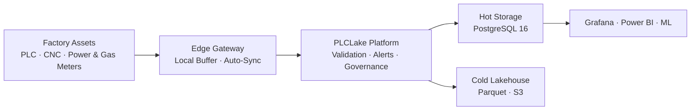
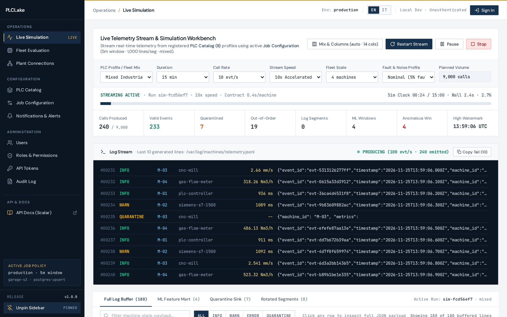
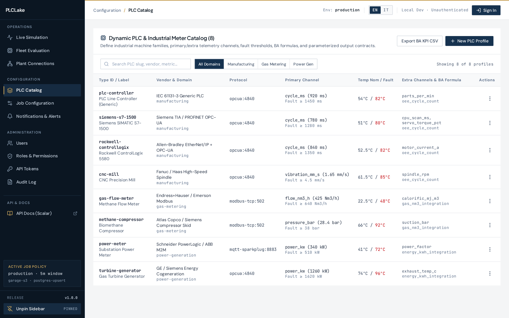
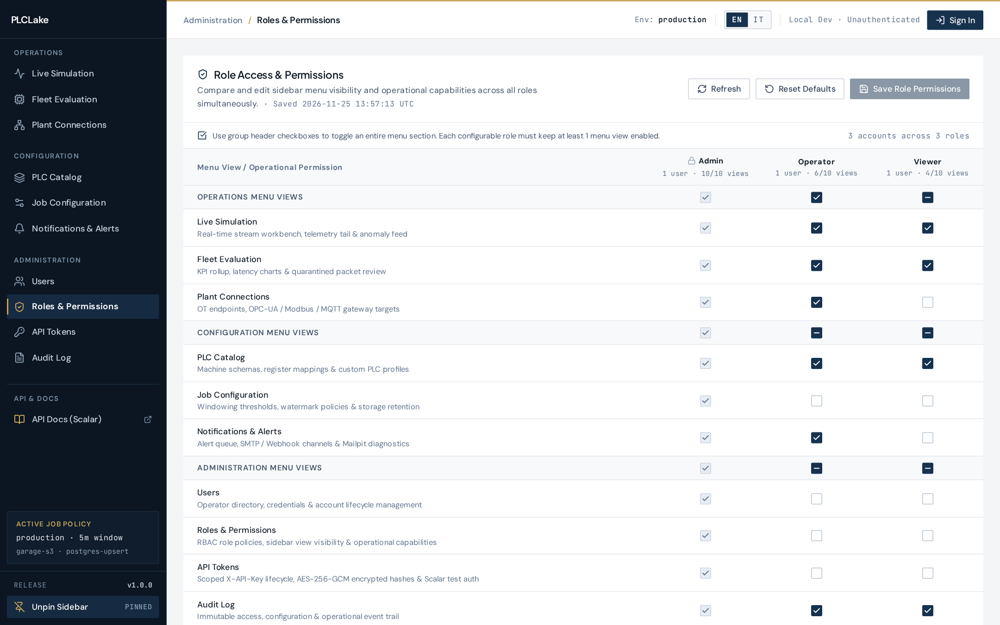
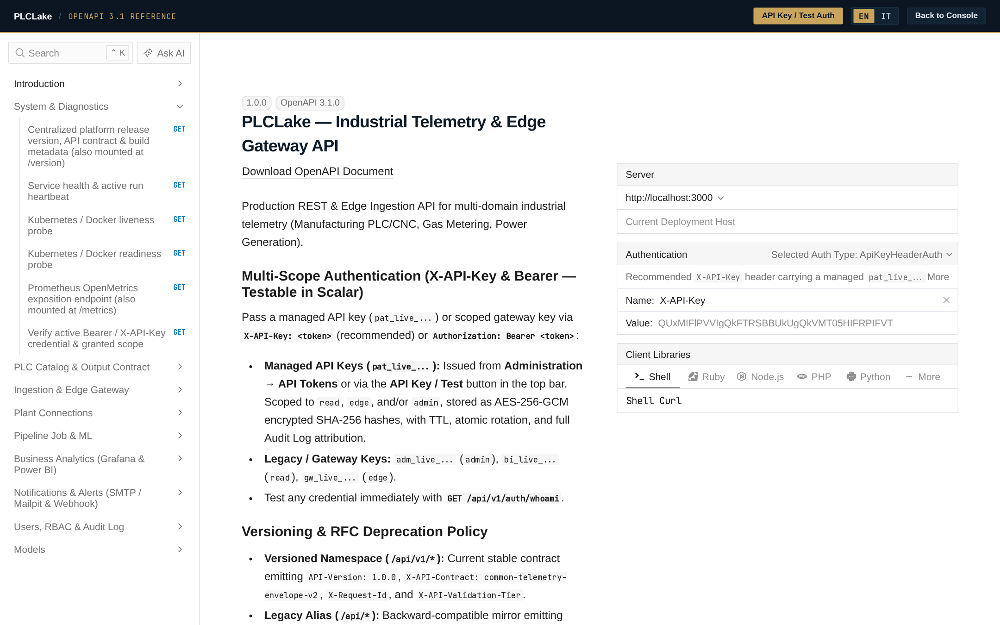

# PLCLake — Industrial Telemetry Connector

**Industrial Telemetry, Edge Gateway & ML Lakehouse Platform**

<p align="center">
  <strong>English</strong> · <a href="README.it.md">Italiano</a>
</p>

<!-- BADGES:START -->
<p align="center">
  
  
  
  
  
  <br />
  
  
  
  
  
</p>
<!-- BADGES:END -->

---

## What is PLCLake?

**PLCLake** collects live data from factory machines (PLCs, CNC mills, compressors, power and gas meters) and turns it into **real-time operational visibility**, **early fault alerts**, and **clean analytics datasets** for Grafana, Power BI, and Predictive Maintenance — without requiring complex or expensive big-data clusters on the shop floor.

It is built to run **on-premise inside a plant**, in **isolated (air-gapped) networks**, or on **cloud / Kubernetes** environments.



---

## Value by Audience

| Audience | What PLCLake Delivers |
| :--- | :--- |
| **Plant & Operations Managers** | Live monitoring of machine status, anomalies, and downtime, with automated email and webhook alerts before failures escalate. |
| **Business & Finance Controllers** | Clean, structured daily feeds for availability (OEE), downtime hours, energy usage (kWh), and gas volume (Nm3) ready for Power BI and Grafana. |
| **CTO, Tech Leads & IT/OT Teams** | Lightweight, maintainable full-stack architecture (React, TypeScript, Node.js, PostgreSQL, Python Edge), typed OpenAPI 3.1 APIs, enterprise RBAC, and turnkey Docker/Helm deployment. |

---

## Platform Preview

### Live Telemetry Streaming


### Core Views at a Glance

<table>
  <tr>
    <td width="50%" valign="top">
      <a href="docs/assets/screenshots/01-live-console-en.png"></a>
      <br />
      <strong>1. Live Operations Console</strong><br />
      Real-time KPI counters, quarantined anomalies, and raw JSON telemetry inspection.
    </td>
    <td width="50%" valign="top">
      <a href="docs/assets/screenshots/02-plc-catalog-en.png"></a>
      <br />
      <strong>2. Dynamic PLC Catalog</strong><br />
      Configure Siemens, Rockwell, CNC, Gas, and Power profiles, protocols, and thresholds.
    </td>
  </tr>
  <tr>
    <td width="50%" valign="top">
      <a href="docs/assets/screenshots/03-rbac-roles-en.png"></a>
      <br />
      <strong>3. Role-Based Access Control (RBAC)</strong><br />
      Manage view visibility and permissions for <code>Admin</code>, <code>Operator</code>, and <code>Viewer</code> roles.
    </td>
    <td width="50%" valign="top">
      <a href="docs/assets/screenshots/04-api-docs-en.png"></a>
      <br />
      <strong>4. Interactive OpenAPI 3.1 Portal</strong><br />
      Explore and test all 51 typed endpoints with built-in authentication and <code>EN | IT</code> docs.
    </td>
  </tr>
</table>

---

## Key Capabilities

- **Live Telemetry & Simulation Console**: Monitor incoming machine streams, inspect raw JSON payloads, isolate malformed records automatically in quarantine, and evaluate fleet health in real time.
- **Dynamic PLC Catalog & Plant Connectivity**: Configure industrial assets (Siemens, Rockwell, CNC, Gas, Power) with custom channels, connectivity probes, and zero-downtime edge auto-sync.
- **Security, Access Control & Auditability**: Role-based access (`Admin`, `Operator`, `Viewer`), managed API keys with expiration and rotation, encrypted credentials at rest, and an immutable audit log of every operational change.
- **Bilingual by Design (`EN | IT`)**: Web console, interactive API portal, and technical documentation are synchronized 1:1 in English and Italian.
- **Deployment Ready**: Centralized release versioning (`config/app.json` + `/api/v1/version`), hardened non-root Docker image, turnkey on-premise Compose stack, Kubernetes/k3s Helm chart, and automated CI/CD quality gates.

---

## Architecture Highlights (For Technical Teams)

- **Zero Over-Engineering**: PostgreSQL 16 + PgBouncer for fast recent queries ("Hot" tier) paired with compressed Parquet on S3 ("Cold" tier) — no Kafka or Spark clusters to maintain on-site.
- **Contract-First APIs**: 51 OpenAPI 3.1 endpoints generated directly from Zod schemas, with two-tier validation (`permissive` for resilient ingestion, `strict` for integrations) and interactive Scalar docs.
- **Production Observability**: Built-in `/healthz`, `/readyz`, `/api/v1/version`, Prometheus `/metrics`, redacted structured JSON logs, and pre-provisioned Grafana dashboards.

Deep-dive technical guides are available in the [Documentation Hub](docs/index.md).

---

## Quick Start

### Local Development

```bash
cp .env.example .env
npm install
npm run hooks:install
npm run dev
```

### Production Stack with Docker

Launches **PLCLake + PostgreSQL 16 + Mailpit + Prometheus + Grafana** in one command:

```bash
docker compose up -d --build
```

| Service | URL |
| :--- | :--- |
| **Web Console (EN / IT)** | `http://localhost:3000` |
| **Release Version API** | `http://localhost:3000/api/v1/version` |
| **Interactive API Docs (EN)** | `http://localhost:3000/api/v1/docs?lang=en` |
| **Interactive API Docs (IT)** | `http://localhost:3000/api/v1/docs?lang=it` |
| **Prometheus Metrics** | `http://localhost:3000/api/v1/metrics` |

For customer server installations or Staging/Production clusters, see:
- **[On-Premise & Air-Gapped Docker Deployment](deploy/onprem/README.md)**
- **[Kubernetes / k3s Helm Chart (Staging & Production)](deploy/helm/plclake/README.md)**

---

## Documentation

All documentation is mirrored 1:1 in English and Italian:

- **[Documentation Hub (EN / IT)](docs/index.md)**
- **[OT/IT Topology & Edge Gateway](docs/en/architecture/ot-it-topology.md)**
- **[Hot/Cold Lakehouse & Big Data](docs/en/architecture/hot-cold-lakehouse.md)**
- **[Dynamic PLC Catalog & Output Contract](docs/en/guides/plc-catalog-and-output.md)**
- **[Day 1 Guide: PLC to Grafana & Power BI](docs/en/guides/grafana-powerbi.md)**
- **[Security: Auth, API Keys & Hardening](docs/en/security/api-auth-and-hardening.md)**
- **[API Reference & Data Extraction Guide](docs/en/api/reference.md)**
- **[i18n, CI & Maintainer Governance](docs/en/guides/i18n-and-docs-governance.md)**

---

## Quality & Maintenance Commands

```bash
npm run verify         # Full pre-push gate (TypeScript, ESLint, Biome, i18n, Vitest, Frontend & Server builds)
npm test               # Automated security, RBAC, token lifecycle, DB & API integration tests
npm run sync:badges    # Sync config/app.json version across package.json, Helm Chart & README badges
npm run docs:openapi   # Export static EN/IT OpenAPI 3.1 specs
```

---

## License

Licensed under the [Apache License 2.0](LICENSE).
